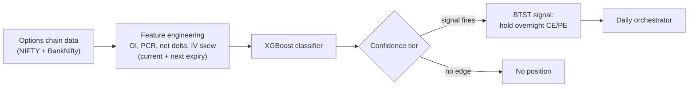
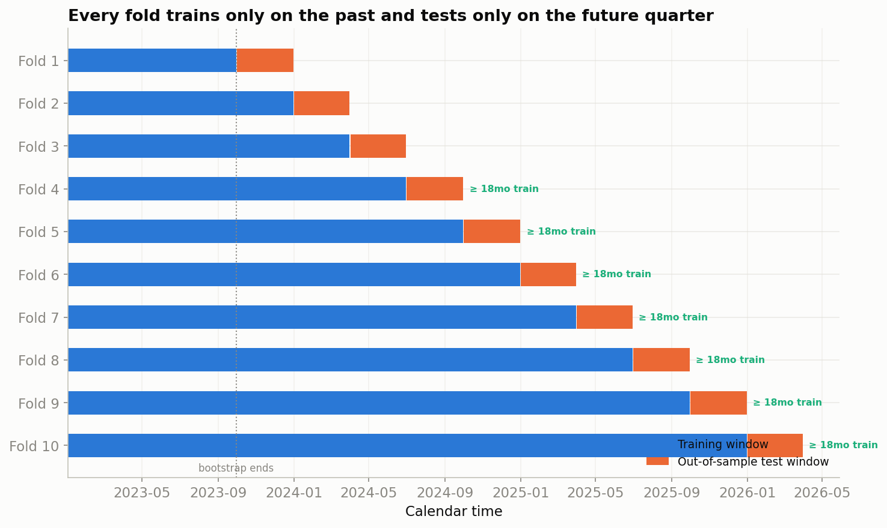
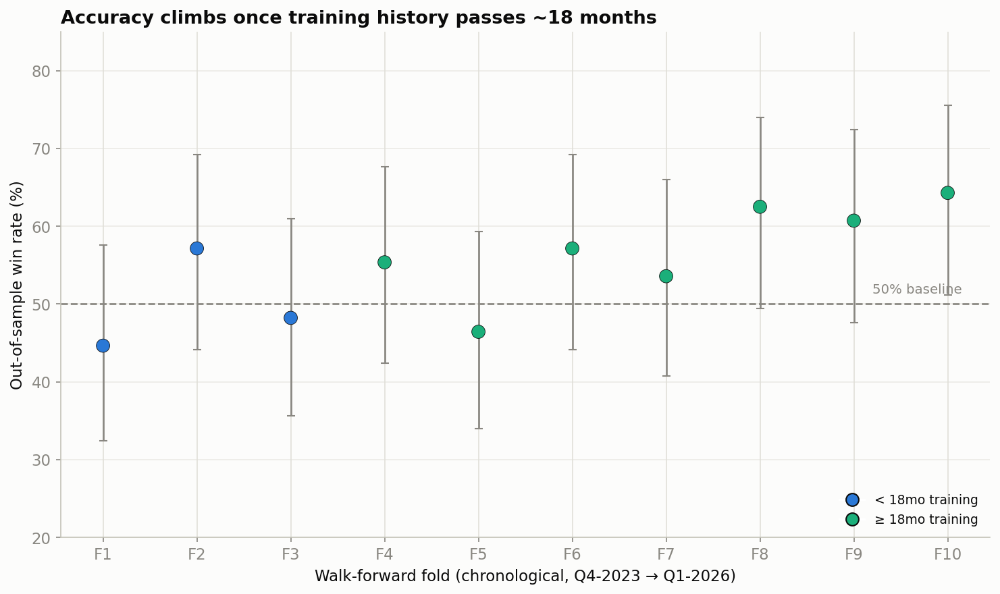
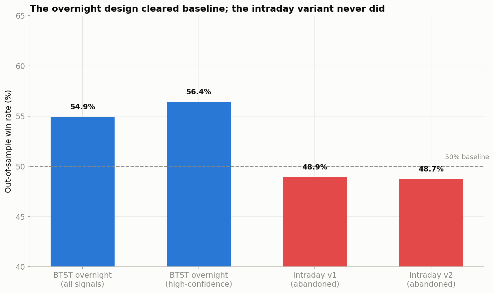

# Datashots — NIFTY/BankNifty Options BTST Signal Engine

A quantitative signal engine for NIFTY/BANKNIFTY index options, deciding
once a day whether to hold an overnight (BTST) CE/PE position.

## Result at a glance

| | |
|---|---|
| **Validation** | 10-fold expanding walk-forward, quarterly, Oct 2023 – Mar 2026 (first 185 days training-only bootstrap) |
| **Overall OOS win rate** | 54.9% over 566 out-of-sample days (50% baseline) |
| **Per-fold win rates** | 45, 58, 48, 56, 47, 58, 53, 63, 61, 65 (%) |
| **Mature-fold subset** (folds 8–10, ≥18mo training history) | 61–65% individually, 63.6% blended (95% CI 56.5–70.2%), n≈187 |
| **High-confidence subset** | 56.4% |
| **Abandoned intraday variant** (shown, not hidden) | 48.9% (v1) / 48.7% (v2) — both below baseline |
| **Documented P&L** | +5,596 pts total · avg win +77.2 / avg loss −72.3 pts · max drawdown −1,664 pts |

All numbers are from walk-forward out-of-sample backtests, not live trading.
Full derivation and caveats: [`notebooks/01_eda_and_validation.ipynb`](notebooks/01_eda_and_validation.ipynb).

## How it works



Features are built from options-chain OI, put-call ratio, net delta, and
IV-skew, across the current and next expiry, cross-confirmed between NIFTY
and BankNifty. One XGBoost classifier decides, once a day, whether to hold
an overnight position and which side. Validation is a 10-fold **expanding**
walk-forward split: each fold's test quarter starts exactly where the prior
fold's training window ends, training only ever grows forward, and every
win rate above comes from a model that had never seen its own test quarter
during training — not a single backtest run once over the whole period.

## Validation discipline and the null result

Folds 1, 3 and 5 are at or below baseline (45%, 48%, 47%). From fold 6
onward every fold is at or above 53%, and the last three folds reach 61 to
65%. That pattern is the basis for treating this as a maturing model rather
than a fixed-accuracy one — though it isn't perfectly monotonic: fold 5
dips back to baseline despite having more training history than several
folds before it. Before settling on
the overnight design, an **intraday** variant (predicting NIFTY's
9:30am–3:00pm move from opening-range features) was tested and abandoned —
it scored 48.9% / 48.7% across two iterations, both below the 50% baseline.
It's kept in this repo and documented alongside the working result, not
dropped from the writeup.

## Charts



*Figure 5 — the 10-fold expanding walk-forward scheme actually used to
produce the win rates above: each fold's training window only grows
forward, never backward or into its own test quarter.*



*Figure 6 — published per-fold win rates, with a 95% Wilson interval per
fold (fold-level N is approximated as 566/10, so interval widths are
illustrative of typical uncertainty, not exact).*



*Figure 12 — the working overnight design against the abandoned intraday
variant: the only comparison in this repo between a result that cleared
baseline and one that didn't.*

The notebook also includes a calibration curve and confusion matrix
(Figures 7–8) — those are proxy-task diagnostics computed live on the
public sample to sanity-check the classifier's behavior, not production-model
results, and are not reproduced here. The public validation notebook uses
37 engineered features; the production pipeline's feature set is computed
from private training data and its exact size isn't published here. Two
further figures in the notebook
(cumulative points and rolling accuracy) are built from a synthetic,
randomly-ordered reconstruction of the documented fold statistics, since the
real trade-by-trade order is proprietary — they're useful for shape, not as
a restatement of the numbers above, and are intentionally left out of this
README; see the notebook if you want them, with their caveats attached.

## What's in this repo vs what's private

- **Public, in this repo:** the pipeline code, the validation design, the
  published aggregate and per-fold results above, and a 290-row random
  sample of engineered features (`data/sample/`) for running the notebook
  end-to-end.
- **Private, not in this repo:** the full multi-year feature/label dataset,
  the production labels, the raw options-chain cache, and the trained
  model artifacts — all proprietary and gitignored. The sample exists
  purely so the exploratory notebook can run for anyone reading the code;
  it is not the dataset the live model is trained or evaluated on.

## Repository structure

- `btst_engine/` — core pipeline: expiry handling, signal building,
  rule-based + ML signal generation, backtesting, daily orchestrator.
- `intraday_engine/` — the abandoned intraday variant, kept for reference.
- `pipelines/data_backed/` — entry points for the data-driven fetch/tag/live
  flow.
- `live/` — production launcher(s) for the live routine.
- `data/sample/` — a small, clearly-labeled sample slice of feature data,
  safe to commit (everything else under `data/` is gitignored).
- `notebooks/` — EDA and validation notebook, runnable end-to-end on
  `data/sample/`.
- `assets/` — figures exported from the notebook.
- `_archive/` — retired experiments and superseded modules, kept for
  history.

## Setup

```bash
pip install -r requirements.txt
cp .env.example .env
# then edit .env with your own broker credentials (DHAN_ACCESS_TOKEN, DHAN_CLIENT_ID)
```

`.env` is gitignored and must never be committed. No data files, model
artifacts, or credentials are committed anywhere in this repo. To explore
the validation notebook on the included sample:

```bash
jupyter notebook notebooks/01_eda_and_validation.ipynb
```

## Limitations and honest caveats

- **Sample size.** 566 out-of-sample days is enough to clear the 50%
  baseline with a 95% Wilson interval, but the margin is not large — the
  mature-fold subset most representative of current behavior is only
  n≈187.
- **Regime dependence.** The entire walk-forward window (Oct 2023 – Mar
  2026) sits within one broad market period; performance under a
  materially different volatility regime is untested.
- **Execution assumptions.** Documented P&L is point-based, as recorded in
  the walk-forward evaluation; this repo does not separately document
  slippage, fill, or transaction-cost modeling.
- **Early-fold weakness is real, not smoothed over.** Three of the first
  five folds (1, 3 and 5) land at or below baseline — included here
  deliberately rather than only reporting the mature-fold subset.

## Disclaimer

For educational and research purposes. Not financial advice.

## Author

[LinkedIn](https://www.linkedin.com/in/mudit-popli-78558b206)
